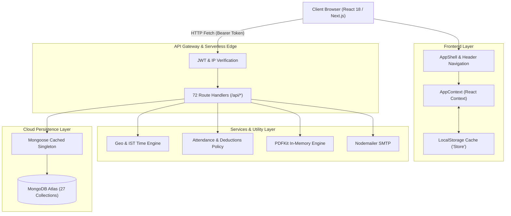

# CEGS OS — System Architecture & Directory Structure
**Prepared for:** Career Experts Global Solutions (CEGS)
**Document Version:** 1.0
**Audit Date:** November 2026

---

## 1. High-Level Architectural Pattern

CEGS OS utilizes a **Serverless Full-Stack Next.js Architecture** paired with a **Dual-Store State Strategy**:



---

## 2. The Dual-Store State Strategy

One of the defining architectural characteristics of CEGS OS is its **Hybrid Persistence Architecture**:

1. **Authoritative Persistence (MongoDB Atlas):**
   * All master records — users, credentials, attendance punches, official client invoices, leave applications, IT tickets, joiners, and candidate entries — are permanently stored in cloud MongoDB Atlas collections.
2. **Fast-Cache Local Persistence (`Store` in `HrmsLegacy.jsx`):**
   * On application bootstrap (`src/contexts/AppContext.jsx`), the client loads an in-memory snapshot (`Store.load()`) cached in the browser's `localStorage`.
   * When an authenticated session is established, API calls (`/api/auth/session`, `/api/users`, etc.) hydrate and synchronize the latest MongoDB truth into the client's local store.
   * This provides instantaneous UI rendering and offline-resilient tab switching without waiting for network round-trips on every simple navigation.

---

## 3. Application Entry Points & Lifecycle

### 3.1 Initial Route Load
* **Root Entry (`src/app/page.js`):**
  * When a user visits `https://hrms-cegs.vercel.app/`, `src/app/page.js` detects the root request and issues a redirect to `/dashboard` (or `/login` if unauthenticated).
* **Root Layout (`src/app/layout.js`):**
  * Injects the Inter Google Font stylesheet and wraps the entire DOM inside `<AppProvider>` from `src/contexts/AppContext.jsx`.
* **Authenticated Layout (`src/app/(app)/layout.jsx`):**
  * Renders `<AppShell>`, which provides the persistent top header (`AppHeader.jsx`), role-aware navigation dropdowns (`NavDropdown.jsx`), live clock-in timer, company visit status badge, breadcrumbs (`RouteWayfinding.jsx`), and notification toast listeners.

---

## 4. Role-Based Navigation System (`src/lib/nav.js`)

CEGS OS separates routes and views using a single source of truth defined in [`src/lib/nav.js`](file:///c:/Users/dell/Desktop/hrms/src/lib/nav.js).

### Route Mapping (`VIEW_TO_PATH`):
The application maps 45+ internal view keys to standardized URL routes:
* Core: `/dashboard`, `/users`, `/settings`, `/employees`, `/reports`, `/profile`, `/directory`, `/announcements`, `/exit`, `/notifications`
* Campaign & Recruitment: `/campaign/recruitment`, `/campaign/hub`, `/campaign/targets`, `/campaign/workflows`, `/campaign/rewards`, `/campaign/jobs`, `/campaign/meetings`, `/campaign/onboarding`, `/campaign/performance`, `/campaign/learning`, `/campaign/timesheets`
* Target Datasheets: `/campaign/targets/calls`, `/campaign/targets/interviews`, `/campaign/targets/walkins`, `/campaign/targets/selected`, `/campaign/targets/joined`
* IT & Dev: `/it/support`, `/it/tasks`, `/admin/it-tasks`
* Billing & Governance: `/billing/workstation`, `/billing/payroll`, `/billing/organizations`, `/billing/permissions`, `/billing/departments`, `/billing/policies`, `/billing/integrations`, `/billing/audit-logs`, `/billing/security`, `/billing/attendance`, `/billing/leaves`, `/billing/documents`, `/billing/assets`, `/billing/auditor`
* Finance: `/finance/invoices`
* Super Admin System: `/admin/orgchart`, `/admin/expenses`, `/admin/tasks`, `/admin/backups`, `/admin/system-health`, `/admin/api-monitor`, `/admin/query-terminal`

---

## 5. Detailed Source Directory Map

```
src/
├── app/                                # Next.js 14 App Router Directory
│   ├── (app)/                          # Route Group: Authenticated views with Header & Shell
│   │   ├── layout.jsx                  # Persistent application shell layout
│   │   ├── admin/                      # Super Admin diagnostics & infrastructure monitoring
│   │   ├── billing/                    # Super Admin HR & Governance (Payroll, Attendance, Leaves)
│   │   ├── campaign/                   # Recruitment Operations, Target Sheets, Joiners
│   │   ├── finance/                    # Client Invoicing (Weekly Update -> Cleared Register)
│   │   ├── it/                         # IT Helpdesk and Daily Task Tracker
│   │   ├── dashboard/                  # Main landing dashboard
│   │   ├── employees/                  # Employee Directory & HR Management
│   │   ├── directory/                  # Company Phone & Staff Directory
│   │   ├── profile/                    # Personal Employee Profile
│   │   ├── settings/                   # System Settings & Company Profile
│   │   ├── announcements/              # Company-wide announcements feed
│   │   ├── notifications/              # Inbox for notifications and alerts
│   │   ├── reports/                    # Executive & Recruiter productivity reports
│   │   ├── helpdesk/                   # Workplace & IT ticketing system
│   │   ├── exit/                       # Resignation & Employee offboarding
│   │   └── users/                      # Super Admin user accounts management
│   │
│   ├── (auth)/                         # Route Group: Unauthenticated authentication views
│   │   └── login/                      # Login screen with WFO/WFH selector & Geofence
│   │
│   ├── api/                            # Backend REST Route Handlers (72 Endpoints)
│   │   ├── admin/                      # Employee onboarding, user management, permissions
│   │   ├── attendance/                 # Check-in, check-out, visit status, cron mark-absent
│   │   ├── attendance-warnings/        # Attendance warning tracker & deduction trigger
│   │   ├── auth/                       # Login, session, check-ip, verify-location
│   │   ├── campaigns/                  # Monthly recruitment targets & hub calculations
│   │   ├── candidates/                 # Recruiter daily candidate call records
│   │   ├── chat-groups/                # Team chat channels & group memberships
│   │   ├── client-invoices/            # Invoice register, PDF downloads, SMTP emails
│   │   ├── clients/                    # Corporate client directory
│   │   ├── departments/                # Corporate departments & LOB processes
│   │   ├── documents/                  # HR document generation & requests
│   │   ├── employees/                  # Employee profile mutations
│   │   ├── expenses/                   # Operational expense tracking
│   │   ├── health/                     # System health check
│   │   ├── it/                         # IT tasks, assignment, review, team directory
│   │   ├── joiners/                    # Joiner entries & weekly billing tracker
│   │   ├── leaves/                     # Leave requests & manager approvals
│   │   ├── messages/                   # Peer-to-peer and group direct messages
│   │   ├── notifications/              # System notifications & broadcast alerts
│   │   ├── onboarding/                 # New hire onboarding checklists
│   │   ├── payroll/                    # Salary computation, warning cuts, payslip records
│   │   ├── settings/                   # System preferences & business hour configuration
│   │   ├── timesheets/                 # Weekly employee timesheet submissions
│   │   ├── users/                      # User management endpoints
│   │   └── walkin-selections/          # Walk-in candidate intake & selections
│   │
│   ├── layout.js                       # Root HTML wrapper with Inter font & AppProvider
│   ├── page.js                         # Root route handler redirecting to /dashboard
│   └── globals.css                     # Master stylesheet & custom utility classes
│
├── components/                         # Modular React Components
│   ├── attendance/                     # Attendance UI, visit tracker, team visits monitor
│   ├── auth/                           # Login form, password reset
│   ├── campaign/                       # Campaign hub, recruiter leaderboards, rewards
│   ├── chat/                           # Messenger modal, notification toasts, emoji picker
│   ├── finance/                        # Invoices table, Bill Raised, Bill Cleared, Totals
│   ├── hrms/                           # Legacy HRMS engine (HrmsLegacy.jsx)
│   ├── it/                             # IT dashboard, task boards, task review modal
│   ├── layout/                         # AppHeader, AppShell, NavDropdown, PageHeader
│   ├── permissions/                    # Role-based permissions matrix
│   ├── recruitment/                    # Joiner sheet, walkin selections, recruitment portal
│   ├── targets/                        # Recruiter daily targets & datasheet views
│   ├── ui/                             # Reusable UI primitives (buttons, modals, badges)
│   ├── views/                          # View wrapper components for app routes
│   └── HRMSApp.jsx                     # Top-level view orchestrator
│
├── contexts/
│   └── AppContext.jsx                  # Master React context provider
│
└── lib/                                # Business Logic, Models, & Helpers
    ├── models/                         # 27 Mongoose ODM Schemas
    ├── attendance-deductions.js        # Salary cut formulas for warnings & absentees
    ├── attendance-policy.js            # Lunch windows, login deadlines, grace periods
    ├── attendance-warnings-ui.js       # Warning badge helpers
    ├── auth-client.js                  # Client JWT token management
    ├── auth.ts                         # Server-side JWT signing/verification, IP filtering
    ├── auto-absent.js                  # Automated absentee detection logic
    ├── campaign-evaluate.js            # Monthly recruitment score calculation
    ├── campaign-joiners.js             # Joiner data aggregation
    ├── campaign-weeks.js               # 8-week follow-up calculations
    ├── candidate-dates.js              # Date formatting & normalization
    ├── client-invoice-rules.js         # Invoice candidate eligibility rules
    ├── db.ts                           # MongoDB Atlas connection singleton
    ├── finance-data.js                 # Invoice state helpers & localStorage sync
    ├── finance-seed-data.json          # Initial client invoice seed data
    ├── generateInvoicePdf.js           # PDFKit Form GST INV-1 generator
    ├── geo.ts                          # Geofencing calculation (Haversine formula)
    ├── ist-time.js                     # India Standard Timezone formatting utilities
    ├── it-tasks-constants.js           # IT task categories & priorities
    ├── leave-policy.js                 # 24-day leave accrual & deduction rules
    ├── messenger-auth.js               # Chat authorization helpers
    ├── nav.js                          # Navigation items, portal definitions, role checks
    ├── page-meta.js                    # Breadcrumb & page title metadata
    ├── recruiter-names.js              # Recruiter name normalization
    └── seed-auth.ts                    # Bootstrap administrative accounts
```

