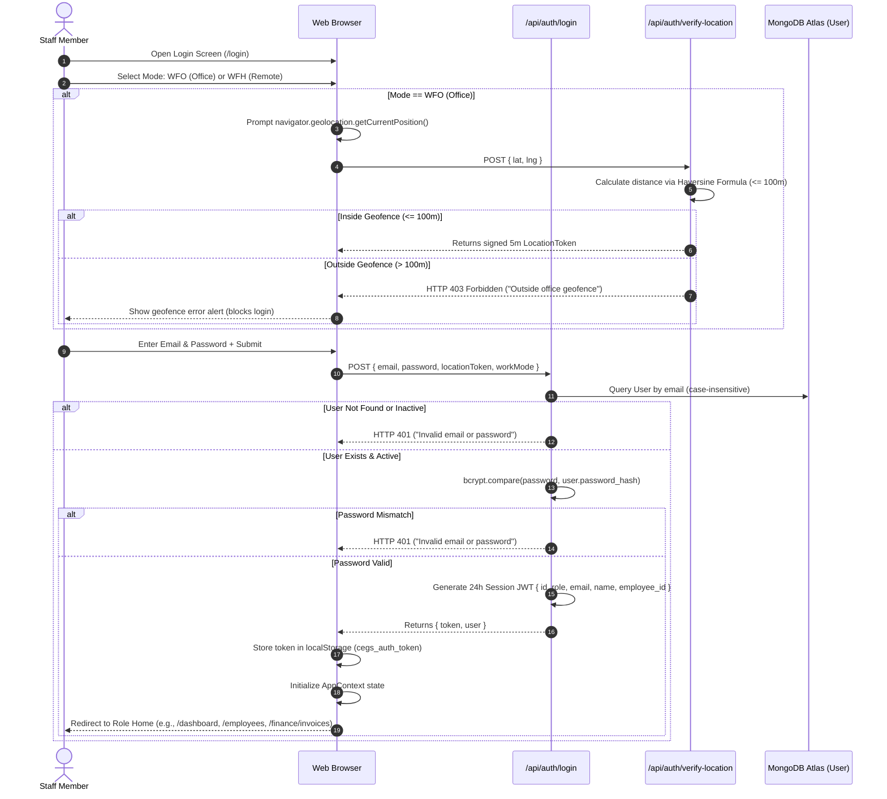
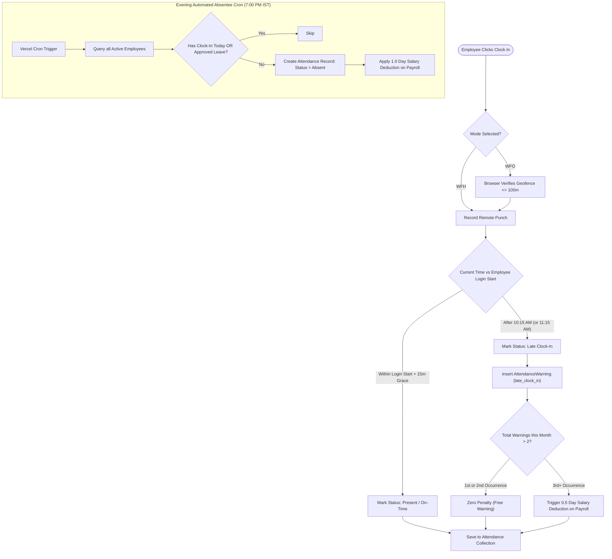
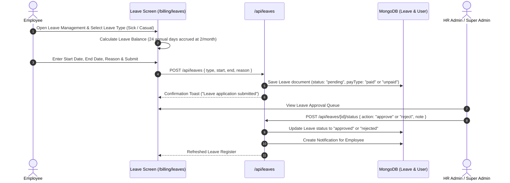
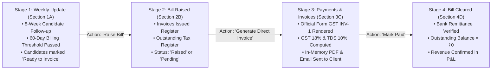
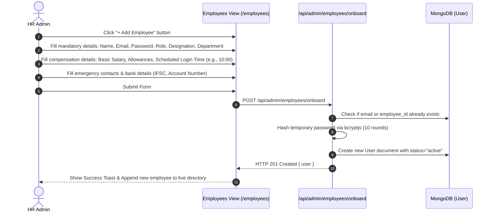

# CEGS OS — End-to-End User Workflows
**Prepared for:** Career Experts Global Solutions (CEGS)
**Document Version:** 1.0
**Audit Date:** November 2026

---

## 1. Authentication & Location-Verified Login Workflow

CEGS OS enforces a strict multi-layer authentication protocol featuring **GPS Geofence Validation for Work-From-Office (WFO)** and **Role-Portal Segregation**.

### Numbered Explanation:
1. **Portal Selection:** User selects their operating mode (Work From Office vs Work From Home).
2. **GPS Geofence Enforcement (WFO):** If WFO is selected, the browser queries the HTML5 Geolocation API. Coordinates are dispatched to `/api/auth/verify-location`. The server computes the distance against the configured office coordinates (`OFFICE_LAT: 13.029861`, `OFFICE_LNG: 77.589167`, `RADIUS: 100m`).
3. **Location Token Minting:** If within 100 meters, a cryptographically signed 5-minute JWT (`locationToken`) is returned.
4. **Credential Verification:** The user submits their email, password, and the location token.
5. **Database Authentication:** The backend checks the `User` collection, validates that the account is `active`, and verifies the password hash using `bcryptjs`.
6. **Session Minting:** Upon success, a 24-hour JWT token is returned, stored in `localStorage`, and used in subsequent HTTP requests via the `Authorization: Bearer <token>` header.

---

## 2. Attendance Tracking & Automated Penalty Workflow

### Key Business Rules:
* **Standard Login Time:** 10:00 AM IST (with 15-minute grace period until 10:15 AM).
* **Special Staff Login Overrides:** Certain employees (e.g., Raheel) have configured start times (11:00 AM with grace until 11:15 AM).
* **Lunch Break Duration:** 30 minutes for Employees (3:00 PM – 3:30 PM); 60 minutes for HR Managers (3:00 PM – 4:00 PM). Returning late logs a `late_lunch_return` warning.
* **Warning Penalty Threshold:** The first 2 warnings in any category per month are free. The 3rd occurrence onward deducts **0.5 days of salary per infraction**.
* **Evening Absentee Sweep:** At 7:00 PM IST Monday–Saturday, any active employee who did not punch in and has no approved leave is automatically flagged as `Absent` (1.0 day salary deduction).

---

## 3. Leave Application & Approval Workflow

---

## 4. End-to-End Client Billing & Invoicing Pipeline (4 Stages)

The core commercial pipeline of CEGS connects placed candidates to cash receipts through a **4-Stage Pipeline**:

### Stage Details:
1. **Weekly Update (A):** Sourcing specialists and recruiters track placed candidates over 8 weeks. Once a candidate completes 60 days of retention and remains active, their status updates to `Ready to Invoice`.
2. **Bill Raised (B):** Grouped candidate batches are converted into raised bills with candidate count, basic placement fee (`bi`), and net revenue margin (`ai`).
3. **Payments & Invoices (C):** Formal client tax invoice is issued with SGST (9%), CGST (9%), client GSTIN, client address, and bank remittance instructions.
4. **Bill Cleared (D):** Once wire transfer/NEFT credit is confirmed in HDFC Bank, invoice is marked `Paid` and archived in the cleared register.

---

## 5. Employee Onboarding Workflow

