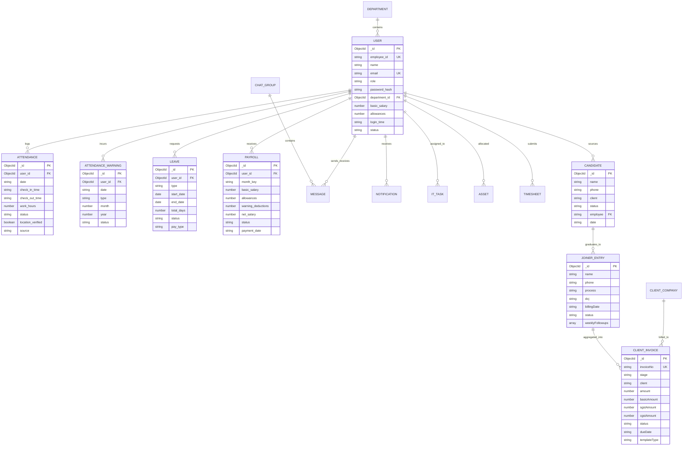

# CEGS OS — Database Architecture & Entity Relationships
**Prepared for:** Career Experts Global Solutions (CEGS)
**Document Version:** 1.0
**Audit Date:** November 2026

---

## 1. Database Overview

* **Database Engine:** MongoDB Atlas (Cloud Cluster, v6.0 / v7.0).
* **Database Name:** `cegs_hrms`.
* **Object-Document Mapper (ODM):** Mongoose `^9.9.1`.
* **Collection Count:** **27 distinct schema collections**.
* **Primary Key Convention:** Standard MongoDB 12-byte BSON `ObjectId` represented as `_id`.

---

## 2. Entity-Relationship Diagram (ERD)

---

## 3. Core Collection Schemas & Field Catalog

### 3.1 `User` Collection (`src/lib/models/User.ts`)
The foundational identity entity for all system users across all roles.
* `_id` (`ObjectId`, PK): Unique user record identifier.
* `employee_id` (`String`, Unique, Indexed): e.g., `"CEGS001"`, `"EMP0001"`.
* `name` (`String`, Required): Full legal name of the employee.
* `email` (`String`, Required, Unique, Lowercase, Indexed): Official login email address.
* `password_hash` (`String`, Required): Bcrypt salted password hash (10 salt rounds).
* `role` (`String`, Enum: `super_admin`, `admin`, `finance`, `it_team`, `employee`): System permission tier.
* `designation` / `title` (`String`): Official job title (e.g. "Senior Recruiter", "HR Manager").
* `department_id` (`ObjectId`, Ref: `Department`): Associated corporate department.
* `joining_date` (`String`): Official date of joining (`YYYY-MM-DD`).
* `status` (`String`, Enum: `active`, `inactive`, `on_leave`, `terminated`): Account status.
* `contact` / `phone` (`String`): Primary contact mobile number.
* `emergency_contact` (`String`): Emergency phone contact.
* `login_time` (`String`, Default: `"10:00"`): Scheduled work start time in HH:mm.
* `basic_salary` (`Number`, Default: `0`): Base monthly compensation.
* `allowances` (`Number`, Default: `0`): Non-taxable monthly allowances.
* `bank_name`, `account_number`, `ifsc_code` (`String`): Bank remittance data for payroll slips.
* `avatar_url` (`String`): Base64 data URL or Dicebear SVG avatar seed.

---

### 3.2 `Attendance` Collection (`src/lib/models/Attendance.js`)
Tracks daily login/logout punches, GPS verification flags, and lunch breaks.
* `_id` (`ObjectId`, PK): Unique punch record.
* `user_id` (`ObjectId`, Ref: `User`, Indexed): Staff member foreign key.
* `date` (`String`, Indexed): Normalized date string (`YYYY-MM-DD`).
* `check_in_time` (`String`): First clock-in timestamp (e.g., `"10:05 AM"`).
* `check_out_time` (`String`): Final clock-out timestamp.
* `work_hours` (`Number`, Default: `0`): Total computed working hours (decimal).
* `status` (`String`, Enum: `present`, `absent`, `half_day`, `late`, `on_leave`): Daily attendance status.
* `source` (`String`, Enum: `office`, `remote`, `auto_absent`, `manual_override`): Punch method.
* `location_verified` (`Boolean`, Default: `false`): Attests GPS coordinates matched the 100m geofence.
* `lat`, `lng` (`Number`): Punch coordinate snapshot.
* `visit_status` (`Object`): Out-of-office field/client visit tracking (`still_away`, `destination`, `returnTime`).
* **Compound Index:** `{ user_id: 1, date: 1 }` (Ensures 1 master record per employee per day).

---

### 3.3 `AttendanceWarning` Collection (`src/lib/models/AttendanceWarning.js`)
Records infractions for company deduction calculation.
* `user_id` (`ObjectId`, Ref: `User`, Indexed): Employee.
* `date` (`String`): Date of infraction (`YYYY-MM-DD`).
* `type` (`String`, Enum: `late_clock_in`, `late_lunch_return`, `early_clock_out`, `score_below_40`): Infraction type.
* `month` (`Number`), `year` (`Number`): Billing period for monthly aggregation.
* `status` (`String`, Default: `"active"`): Active or excused by HR.

---

### 3.4 `ClientInvoice` Collection (`src/lib/models/ClientInvoice.js`)
Commercial register powering the 4-stage client billing pipeline.
* `invoiceNo` (`String`, Indexed): Formal invoice number (e.g., `"INV-2026-ISON-01"`, `"INV-247"`).
* `stage` (`String`, Enum: `to_raise`, `raised`, `cleared`): Current pipeline stage.
* `client` (`String`, Indexed): Corporate client name (e.g., "ISON Xperiences", "Altruist").
* `projectMilestone` (`String`): Candidate placement or service milestone description.
* `amount` (`Number`): Total invoice value including GST.
* `basicAmount` (`Number`): Gross basic recruitment fee excluding GST.
* `sgstAmount` (`Number`, Default: 9%), `cgstAmount` (`Number`, Default: 9%): GST breakdown.
* `dueDate` (`String`), `paidDate` (`String`), `invoiceDate` (`String`): Commercial date milestones.
* `status` (`String`, Enum: `Pending`, `Paid`, `Raised`): Payment status.
* `templateType` (`String`, Default: `"GST_INV_1"`): Custom client print template identifier.
* `items` (`Array` of Line Items): Itemized list of placed candidates with Employee IDs, Names, LOB Process, Rate per Seat, and SAC Code (`99851`).

---

### 3.5 `Leave` Collection (`src/lib/models/Leave.js`)
Tracks employee paid and unpaid time off.
* `user_id` (`ObjectId`, Ref: `User`, Indexed): Requesting employee.
* `type` (`String`, Enum: `casual`, `sick`, `unpaid`): Category of leave.
* `start_date`, `end_date` (`String`): Span of requested leave (`YYYY-MM-DD`).
* `total_days` (`Number`): Calculated calendar days requested.
* `reason` (`String`): Justification submitted by employee.
* `status` (`String`, Enum: `pending`, `approved`, `rejected`): Workflow status.
* `pay_type` (`String`, Enum: `paid`, `unpaid`, `mixed`): Policy determination based on 24-day annual accrual.
* `approved_by` (`ObjectId`, Ref: `User`): Approving manager or HR admin.

---

### 3.6 `Payroll` Collection (`src/lib/models/Payroll.js`)
Stores monthly computed compensation and pay slips.
* `user_id` (`ObjectId`, Ref: `User`, Indexed): Employee.
* `month_key` (`String`, Indexed): Month identifier (`YYYY-MM`).
* `basic_salary` (`Number`), `allowances` (`Number`): Contractual earnings.
* `warning_deductions` (`Number`): Deductions computed from attendance warning breaches (0.5 day per cut).
* `absent_deductions` (`Number`): Deductions for unapproved absent days (1.0 day per cut).
* `net_salary` (`Number`): Final take-home disbursement.
* `status` (`String`, Enum: `draft`, `processed`, `paid`): Settlement lifecycle.
* `payslip_url` (`String`): Generated digital slip identifier.

---

### 3.7 Additional Collections
* **`Candidate` & `JoinerEntry`:** Sourcing intake and 8-week candidate retention tracking.
* **`ItTask` & `Asset`:** IT service desk ticketing, asset serial numbers, and equipment lifecycle.
* **`Message` & `ChatGroup`:** Internal team chat history, message read statuses, and group channels.
* **`Notification`:** Broadcast messages and personalized system alerts.
* **`SystemSetting`:** Key-value store for office geofence coordinates (`OFFICE_LAT`, `OFFICE_LNG`, `OFFICE_RADIUS_M`), grace periods, and persistent flags (`crm_invoices_seeded`, `crm_deleted_invoices`).

